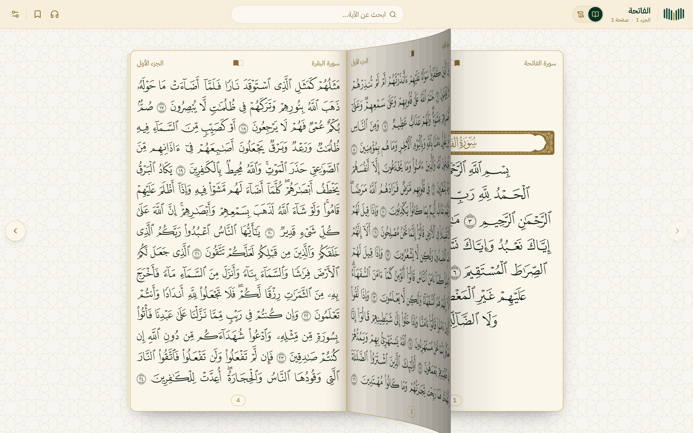
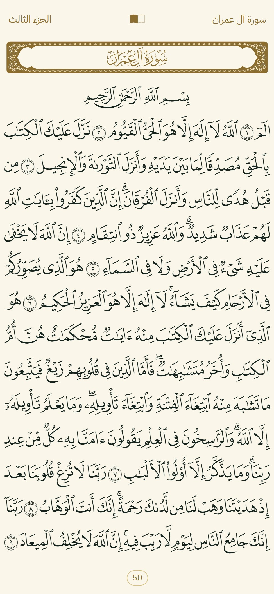
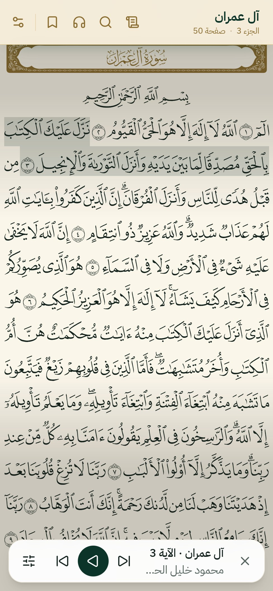
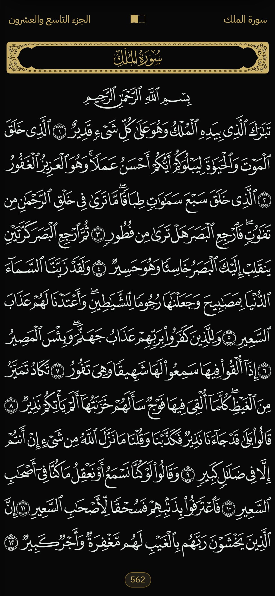
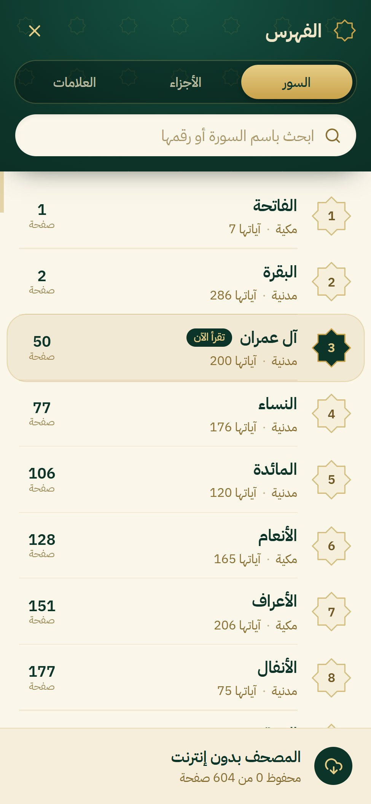
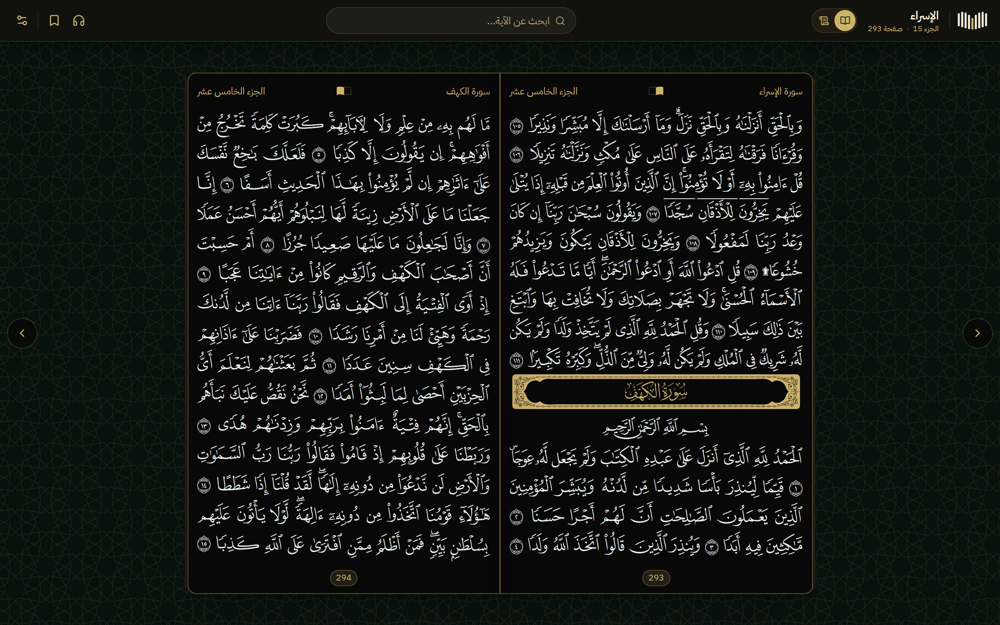
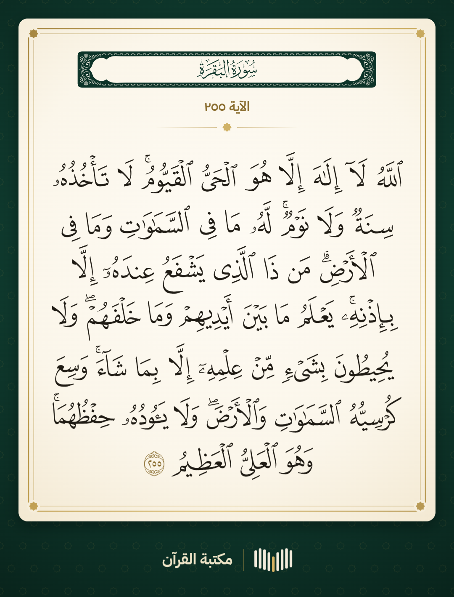
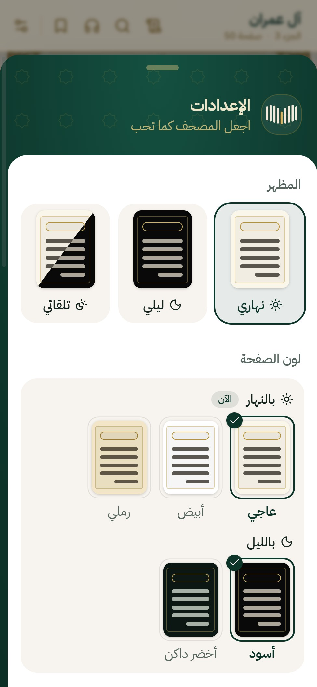
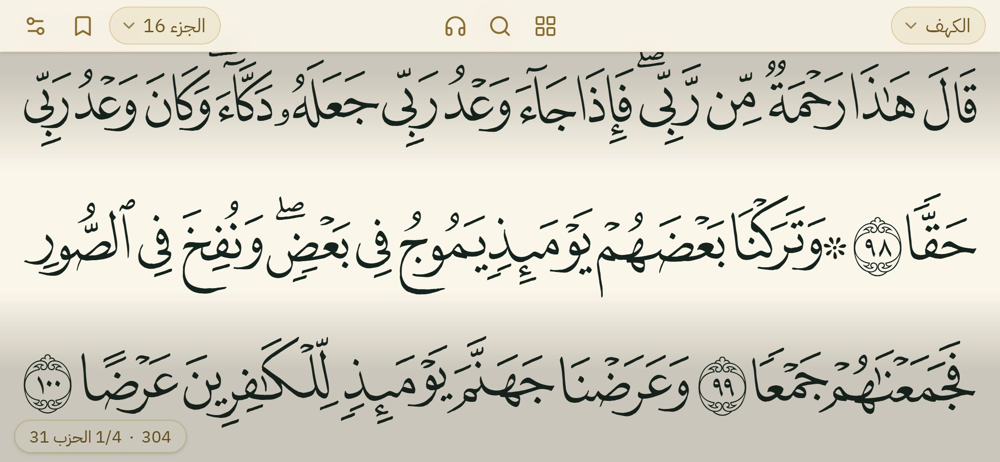

<p align="center">
  
</p>

<h1 align="center">مكتبة القرآن</h1>

<p align="center" dir="rtl">
  <b>المصحف كما طُبع: كتاب مفتوح على شاشتك، كلمة كلمة، مع ثمانية قراء.</b><br>
  مفتوح المصدر ومجاني: المصحف نفسه الذي تشغّله منصتنا «حافظ» في بيئة الإنتاج، جاهزاً لموقعك أو تطبيقك.
</p>

<p align="center"><b>العربية</b> · <a href="README.md">English</a> · <a href="README.tr.md">Türkçe</a></p>

<p align="center">
  
</p>

<p align="center">
  
  
  
  
</p>

## ما الذي تحصل عليه

- **الصفحة كما طُبعت.** مصحف المدينة المنورة طبعة 1421هـ من مجمع الملك فهد (وهو المصحف الذي يعرضه Quran.com و
  Tarteel)، في 604 صفحات، في كل صفحة 15 سطراً، مرسوم بخطوط الصفحات التي صممها المجمع نفسه دون أي تعديل: فيبدو مطابقاً
  للمطبوع على أي شاشة.
- **كتاب مفتوح على الحاسوب.** صفحتان تلتقيان عند الكعب، وعند التقليب ترتفع الصفحة من طرفها وتنقلب فوق الكعب في ثلاثة
  أبعاد. اسحب الصفحة، أو اضغط ← / →، أو استخدم الأسهم.
- **مصمم للهاتف.** الصفحة تملأ الشاشة وتتنحى الأشرطة، ولمسة تعيدها. أدِر الهاتف جانبياً فيتحول المصحف إلى تمرير بعرض
  الشاشة كاملة، وبين الصفحات رقم الصفحة وربع الحزب.
- **كلمة كلمة.** كل كلمة عنصر مستقل يعرف سورته وآيته وموضعه. اضغط مطولاً على آية لتسمعها وحدها، أو لتشاركها صورة
  تليق بالمطبوع.
- **ثمانية قراء متزامنون مع النص.** الحصري والمنشاوي والشريم والمعيقلي والدوسري والعفاسي وعبد الباسط وعلي جابر: ملف
  صوتي واحد لكل صفحة، وشريط مسطح واحد لكل سطر يظلل الآية التي تُتلى، والصفحة تنتقل وحدها؛ كرّر آية أو مقطعاً، وغيّر
  السرعة، واستخدم شاشة القفل.
- **نهاري وليلي كما تحب.** فاتح أو داكن أو تلقائي؛ ولون الصفحة نهاراً (عاجي، أبيض، رملي) وليلاً (أسود، أخضر داكن)؛
  وحركة تقليب الصفحة، وإبقاء الشاشة مضاءة، والانتقال مع القارئ، والعربية / الإنجليزية / التركية.
- **الفهرس والبحث.** السور والأجزاء والعلامات في شاشة واحدة؛ وابحث في الآيات وأسماء السور بالتشكيل أو بدونه، وبالهمزة
  أو بدونها، وبأي صورة للألف.
- **سريع وخفيف ويعمل دون اتصال.** طلب واحد لكل صفحة، وملفات تُخزَّن سنة كاملة؛ كل صفحة تُقرأ تُحفظ على الجهاز، ولا
  يُنزَّل المصحف كله إلا حين يطلب القارئ.
- **استضافة مجانية.** إعداد Cloudflare R2 + Worker خطوة بخطوة، يبقى ضمن الحصص المجانية.
- **لمساعدي الذكاء الاصطناعي.** الملف [`AGENTS.md`](AGENTS.md) و[مهارة Claude Code](skills/quran-mushaf/SKILL.md)
  يتيحان لمساعدك أن يدمج المصحف في تطبيقك بدلاً منك.

<p align="center">
  
</p>

<table dir="rtl">
  <tr>
    <td align="center" width="50%">
      
      <br><sub>اضغط مطولاً على آية ← <b>شارك الآية</b>: صورة بعرض 1080 بكسل، مرسومة بخطوط الصفحات</sub>
    </td>
    <td align="center" width="50%">
      
      <br><sub>الإعدادات: نهاري / ليلي / تلقائي، ولون الصفحة، والقراءة والاستماع</sub>
    </td>
  </tr>
</table>

<p align="center">
  
</p>

## ابدأ في دقيقتين

تحتاج إلى Node 20 أو أحدث.

```bash
git clone https://github.com/ahmadmounir/quran-library.git
cd quran-library/example
npm install
npm run dev
```

افتح `http://localhost:5175`، فيعمل المصحف من مجلد `data/` في هذا المستودع. أما الصوت، فابنِ قارئاً مرة واحدة (تحتاج
إلى Node 20+ و ffmpeg؛ نحو ساعة، معظمها في التنزيل):

```bash
node tools/audio/build-reciter.mjs husary    # أو عدة قراء، أو: all للثمانية
```

تنزّل الأداة تسجيلات القارئ من EveryAyah وتعيد بناء ملفاتنا الصوتية مطابقةً لها تماماً (وتتحقق من ذلك وتخبرك). ولنشر
التطبيق، استضف الملفات على Worker خاص بك في Cloudflare (الدليل، القسم 8) وابنِ التطبيق بعنوانها:
`VITE_FILES_BASE=https://files.example.com/v1 npm run build` ← المجلد `example/dist/`.

## الدليل

الشرح الكامل، من ملفات البيانات إلى الكتاب المفتوح والاستضافة والتخزين المؤقت والتكلفة:

- **العربية** — [docs/ar/GUIDE.md](docs/ar/GUIDE.md)
- **English** — [docs/en/GUIDE.md](docs/en/GUIDE.md)
- **Türkçe** — [docs/tr/GUIDE.md](docs/tr/GUIDE.md)

## محتوى المستودع

| المجلد | المحتوى |
|---|---|
| `data/mushaf/` | 604 ملفات للصفحات (الأسطر والكلمات، ولكل كلمة رمز رسمها ونصها بترميز Unicode)، وفهرس صفحات الآيات، والسور، والنص المجرد للبحث |
| `data/fonts/` | خطوط الصفحات الـ604 (QCF V2، 93 MB) وخط إطارات السور |
| `data/audio/` | القراء الثمانية، ولكل قارئ موضع بداية كل آية داخل ملف كل صفحة |
| `tools/audio/` | بناء ملفات الصفحات الصوتية من تسجيلات الآيات (مطابقة لملفاتنا بايتاً ببايت) |
| `tools/cloudflare/` | الرفع إلى R2، والـ Worker الذي يقدّم الملفات |
| `example/` | تطبيق المصحف (React + Vite + Tailwind): الكتاب المفتوح، والهاتف قائماً وجانبياً، والقراء، ومشاركة الآيات، والإعدادات، والعمل دون اتصال |
| `AGENTS.md` و`skills/` | تعليمات لمساعدي البرمجة بالذكاء الاصطناعي |

الملفات الصوتية نفسها (6.2 GB لثمانية قراء) ليست في git؛ والأدوات تعيد بناءها.

## الاستعانة بمساعد ذكاء اصطناعي

افتح مشروعك في Claude Code (أو أي وكيل برمجة آخر)، واجعل هذا المستودع متاحاً له، ثم اطلب:

> أضف المصحف إلى تطبيقي باتباع quran-library/AGENTS.md

ومع Claude Code يمكنك أيضاً نسخ `skills/quran-mushaf/` إلى `.claude/skills/` في مشروعك.

## الترخيص

الشيفرة والأدلة المكتوبة لهذا المستودع منشورة بموجب [ترخيص MIT](LICENSE). أما الخطوط وبيانات الصفحات والتسجيلات فهي
لأصحابها (انظر أدناه).

## شكر وتقدير

قام هذا العمل على جهود من سبقونا، ونشكرهم شكراً صادقاً:

- **مجمع الملك فهد لطباعة المصحف الشريف** (المدينة المنورة): على مصحف المدينة وخطوط صفحاته (QCF V2)، المستخدمة دون أي
  تعديل.
- **منصة Tarteel — المكتبة القرآنية الشاملة (Quranic Universal Library، QUL)**: على بيانات تخطيط الصفحات ورموز الكلمات
  كلمةً كلمة التي بُنيت منها ملفات صفحاتنا، وعلى خط إطارات السور.
- **موقع Quran.com ومؤسسة Quran Foundation**: على معرّفات الكلمات، وعلى العمل المفتوح الذي أنار لنا الطريق.
- **موقع EveryAyah.com**: على تسجيلات الآيات آيةً آية التي بُنيت منها ملفاتنا الصوتية.
- **القراء**: الشيخ محمود خليل الحصري، والشيخ محمد صديق المنشاوي، والشيخ سعود الشريم، والشيخ ماهر المعيقلي، والشيخ
  ياسر الدوسري، والشيخ مشاري راشد العفاسي، والشيخ عبد الباسط عبد الصمد، والشيخ علي جابر — جزاهم الله خيراً.

جميع الحقوق في الخطوط وبيانات الصفحات والتسجيلات محفوظة لأصحابها. ونحن نشاركها هنا مجاناً، خدمةً غير تجارية لكل من
يخدم كتاب الله. إن كنت تبني شيئاً تجارياً، فاقرأ شروط كل مصدر أولاً.
