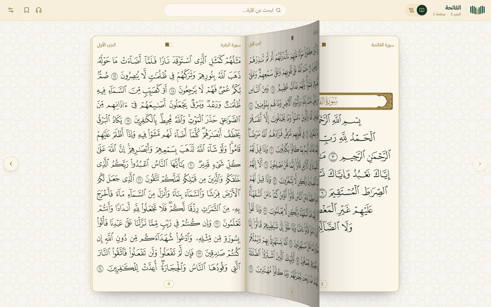
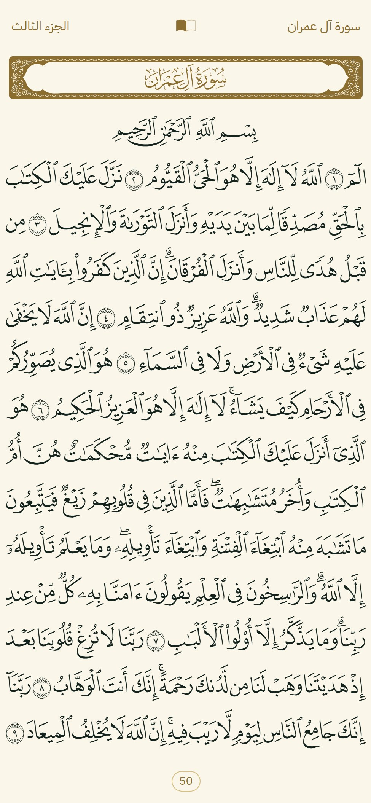
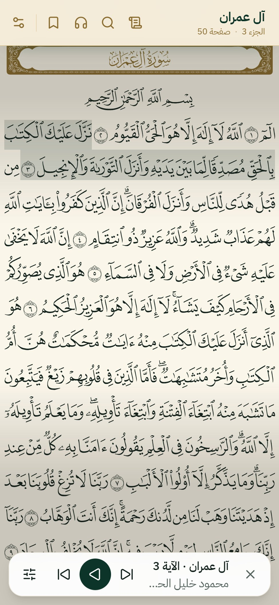
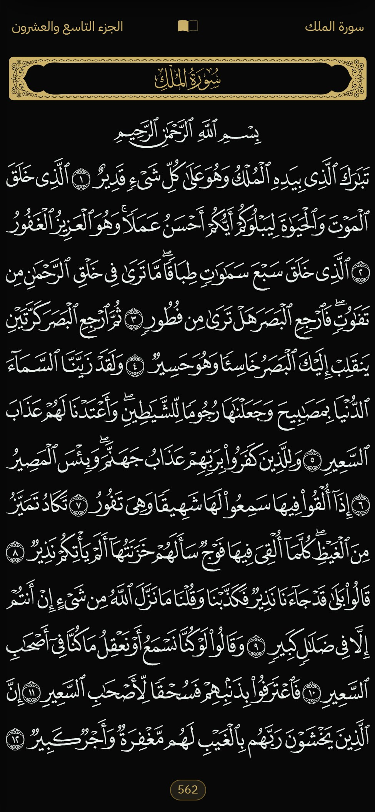
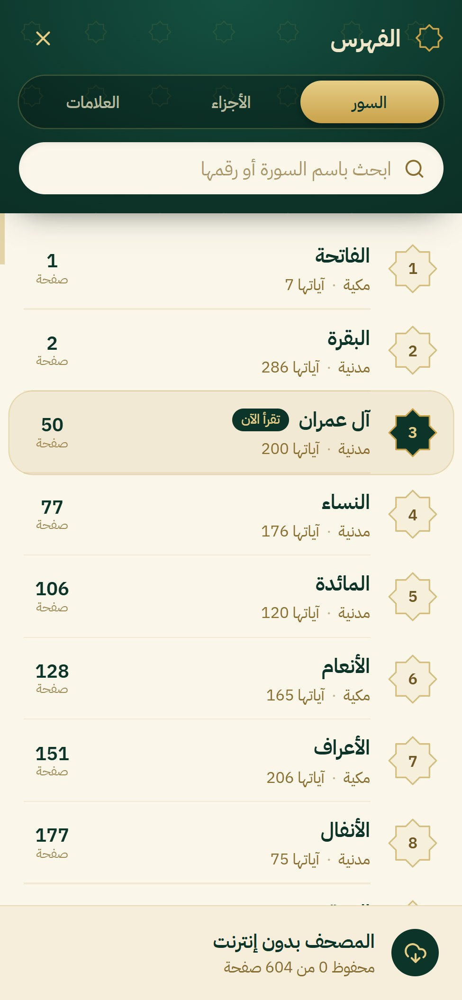
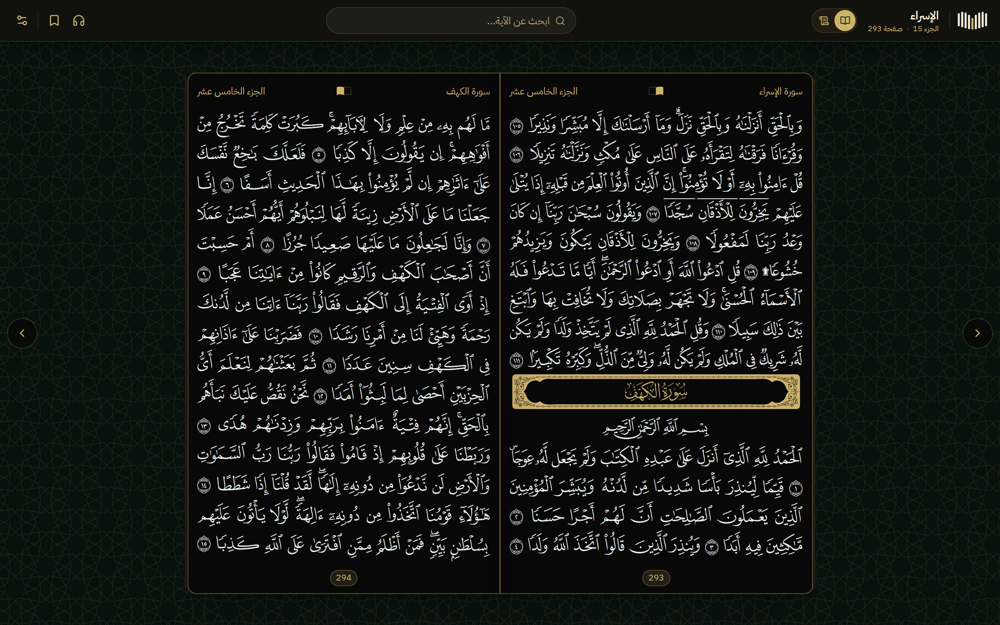
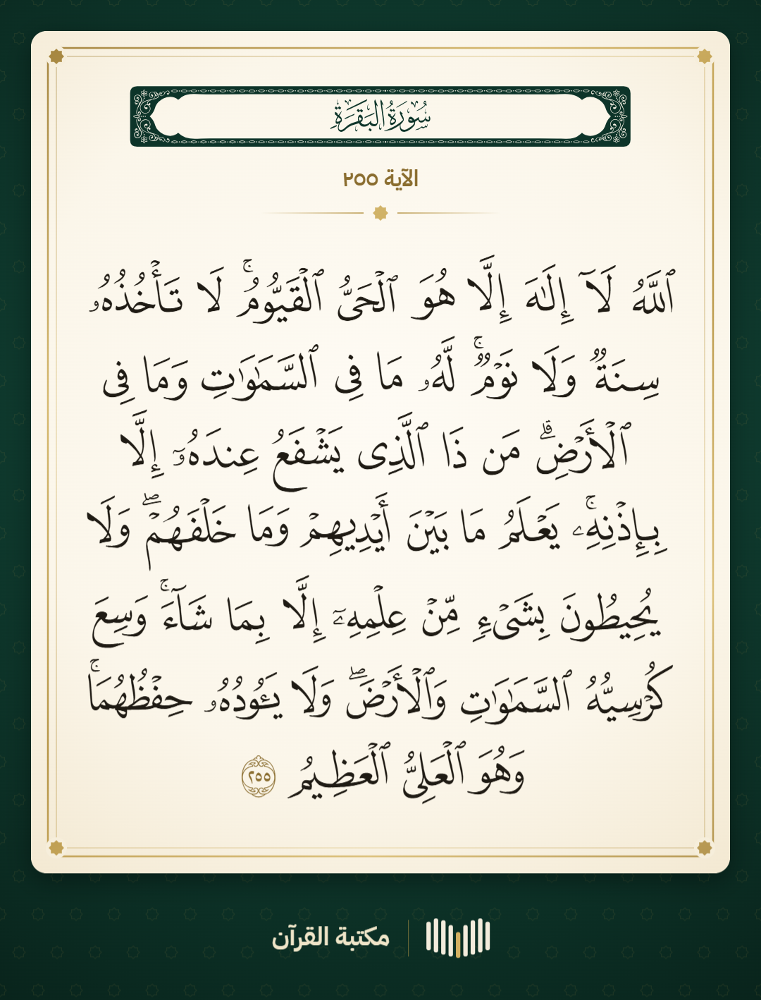
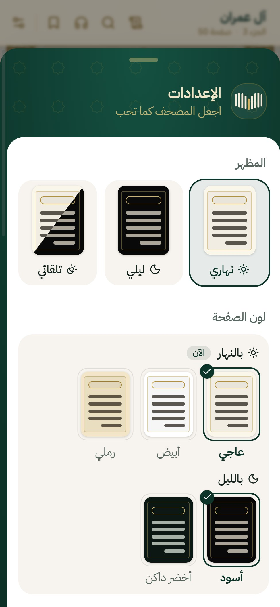
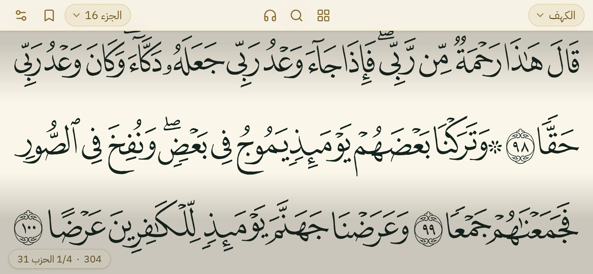

<p align="center">
  
</p>

<h1 align="center">Quran Library</h1>

<p align="center">
  <b>The mushaf as printed — an open book on your screen, word by word, with eight reciters.</b><br>
  Open source and free: the same mushaf our Hafiz platform runs in production, ready for your site or app.
</p>

<p align="center"><a href="README.ar.md">العربية</a> · <b>English</b> · <a href="README.tr.md">Türkçe</a></p>

<p align="center">
  
</p>

<p align="center">
  
  
  
  
</p>

## What you get

- **The printed page.** The 1421H Madinah mushaf of the King Fahd Complex (the one Quran.com and Tarteel show), 604
  pages, 15 lines each, drawn with the Complex's own page fonts, unmodified: it looks exactly like the print on any
  screen.
- **An open book on a computer.** Two pages meet at the spine; turning lifts the page at its edge and lays it over the
  spine in 3D. Drag the page, press ← / →, or use the arrows.
- **Made for phones.** One page fills the screen and the bars step aside; a tap brings them back. Turn the phone
  sideways and the mushaf scrolls across the full width, with the page and the quarter of the hizb between pages.
- **Word by word.** Every word is its own element with its surah, ayah and position. Hold an ayah to hear it alone,
  or to share it as a picture fit for a print.
- **Eight reciters in sync.** Al-Husary, Al-Minshawi, Al-Shuraim, Al-Muaiqly, Al-Dosari, Alafasy, Abdul Basit and Ali
  Jaber: one audio file per page, the ayah being read marked by one flat band per line, the page turns by itself;
  repeat an ayah or a passage, change the speed, use the lock screen.
- **Day and night, your way.** Light, dark or automatic; the page's colour by day (cream, white, sand) and by night
  (black, deep green); the page-turn animation, keeping the screen on, following the reciter, Arabic / English /
  Turkish.
- **Index and search.** Surahs, juz and bookmarks on one screen; search the ayat and the surah names with or without
  harakat, hamza or any form of alef.
- **Fast, light, offline.** One request per page, files cached for a year; every page read is kept on the device, and
  the whole mushaf downloads only when the reader asks.
- **Free hosting.** A step-by-step Cloudflare R2 + Worker setup that stays inside the free tiers.
- **For AI assistants.** [`AGENTS.md`](AGENTS.md) and a [Claude Code skill](skills/quran-mushaf/SKILL.md) let an
  assistant build it into your app for you.

<p align="center">
  
</p>

<table>
  <tr>
    <td align="center" width="50%">
      
      <br><sub>Hold an ayah → <b>Share</b>: a 1080 px picture, drawn with the page fonts</sub>
    </td>
    <td align="center" width="50%">
      
      <br><sub>The settings: day / night / automatic, the page colour, reading and listening</sub>
    </td>
  </tr>
</table>

<p align="center">
  
</p>

## Start in two minutes

You need Node 20 or newer.

```bash
git clone https://github.com/ahmadmounir/quran-library.git
cd quran-library/example
npm install
npm run dev
```

Open `http://localhost:5175` — the mushaf runs from this repository's `data/` folder. For the audio, build a reciter
once (Node 20+ and ffmpeg; about an hour, mostly downloading):

```bash
node tools/audio/build-reciter.mjs husary    # or several ids, or: all
```

It downloads the reciter's recordings from EveryAyah and rebuilds our audio files exactly (it checks and says so).
To put the app online, host the files on your own Cloudflare Worker (the guide, §8) and build it with their address:
`VITE_FILES_BASE=https://files.example.com/v1 npm run build` → `example/dist/`.

## The guide

The full explanation, from the data files to the open book, hosting, caching and cost:

- **العربية** — [docs/ar/GUIDE.md](docs/ar/GUIDE.md)
- **English** — [docs/en/GUIDE.md](docs/en/GUIDE.md)
- **Türkçe** — [docs/tr/GUIDE.md](docs/tr/GUIDE.md)

## What is inside

| Folder | What |
|---|---|
| `data/mushaf/` | 604 page files (lines and words, each word with its glyph code and Unicode text), the ayah→page index, the surahs, the plain text for search |
| `data/fonts/` | the 604 page fonts (QCF V2, 93 MB) and the surah-header font |
| `data/audio/` | the eight reciters and, for each, where every ayah starts inside each page file |
| `tools/audio/` | build the page audio files from the ayah recordings (identical to ours, byte for byte) |
| `tools/cloudflare/` | upload to R2; the Worker that serves the files |
| `example/` | the mushaf app (React + Vite + Tailwind): the open book, phones upright and sideways, reciters, ayah sharing, settings, offline |
| `AGENTS.md`, `skills/` | instructions for AI coding assistants |

The audio files themselves (6.2 GB for eight reciters) are not in git; the tools rebuild them.

## Using an AI assistant

Open your own project in Claude Code (or any coding agent), make this repository available to it, and ask:

> Add the mushaf to my app following quran-library/AGENTS.md

With Claude Code you can also copy `skills/quran-mushaf/` into your project's `.claude/skills/`.

## Licence

The code and the guides written for this repository are under the [MIT licence](LICENSE). The fonts, the page data
and the recordings belong to their owners (see below).

## Thanks

This work stands on the shoulders of others, and we thank them sincerely:

- **King Fahd Glorious Qur'an Printing Complex** (Madinah) — the Madinah mushaf and its page fonts (QCF V2), used
  unmodified.
- **Tarteel — Quranic Universal Library (QUL)** — the page layout data and the word-by-word glyph codes our page files
  are built from, and the surah header font.
- **Quran.com / Quran Foundation** — the word ids and the open work that showed the way.
- **EveryAyah.com** — the ayah-by-ayah recordings our audio files are built from.
- **The reciters** — Sheikh Mahmoud Khalil Al-Husary, Sheikh Mohamed Siddiq El-Minshawi, Sheikh Saud Al-Shuraim,
  Sheikh Maher Al-Muaiqly, Sheikh Yasser Al-Dosari, Sheikh Mishary Rashid Alafasy, Sheikh Abdul Basit Abdul Samad and
  Sheikh Ali Jaber — may Allah reward them.

All rights to the fonts, the page data and the recordings belong to their owners. We share them here freely, as a
non-commercial service to everyone who serves the Book of Allah. If you build something commercial, read each
source's terms first.
