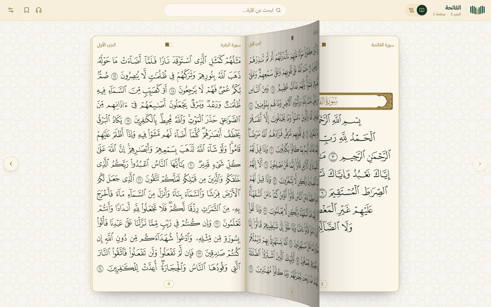
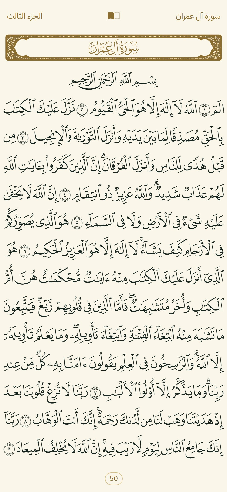
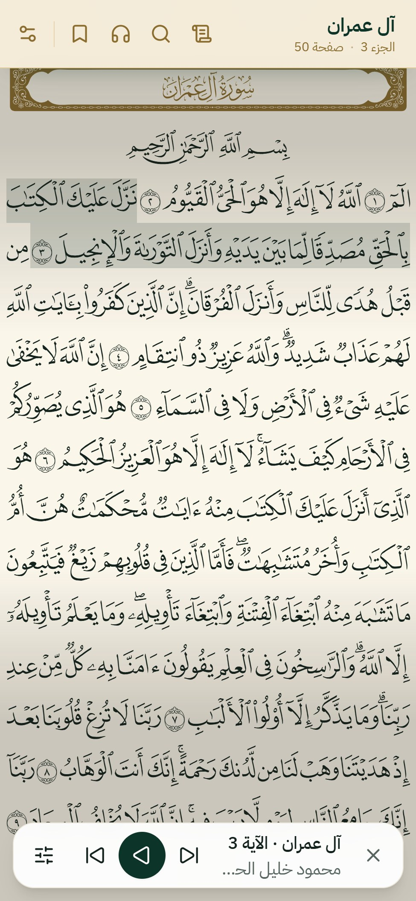
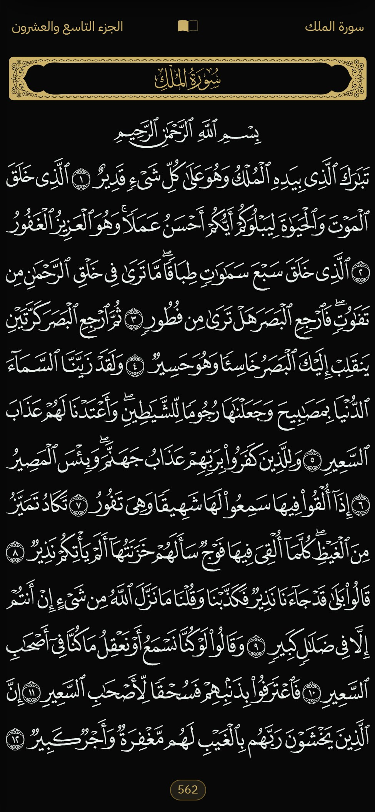
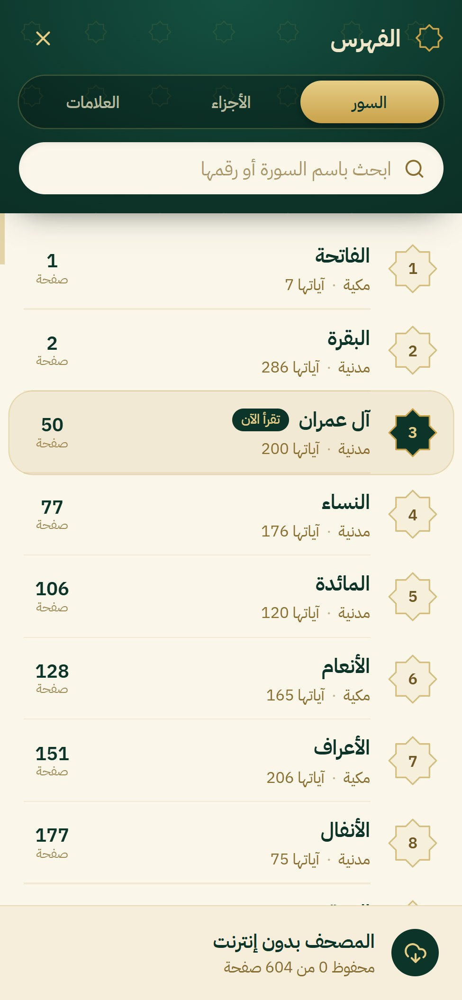
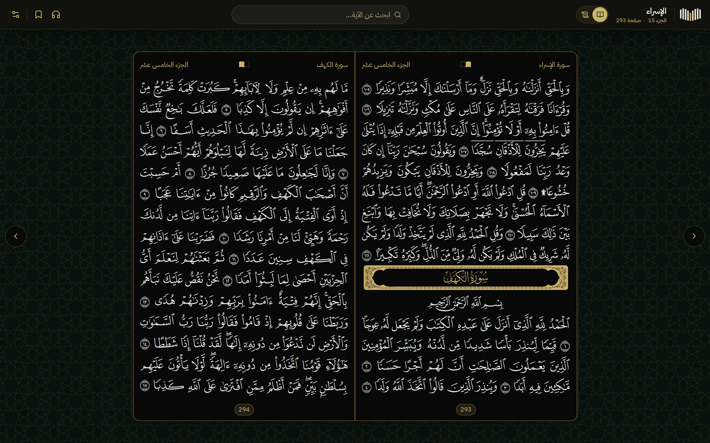
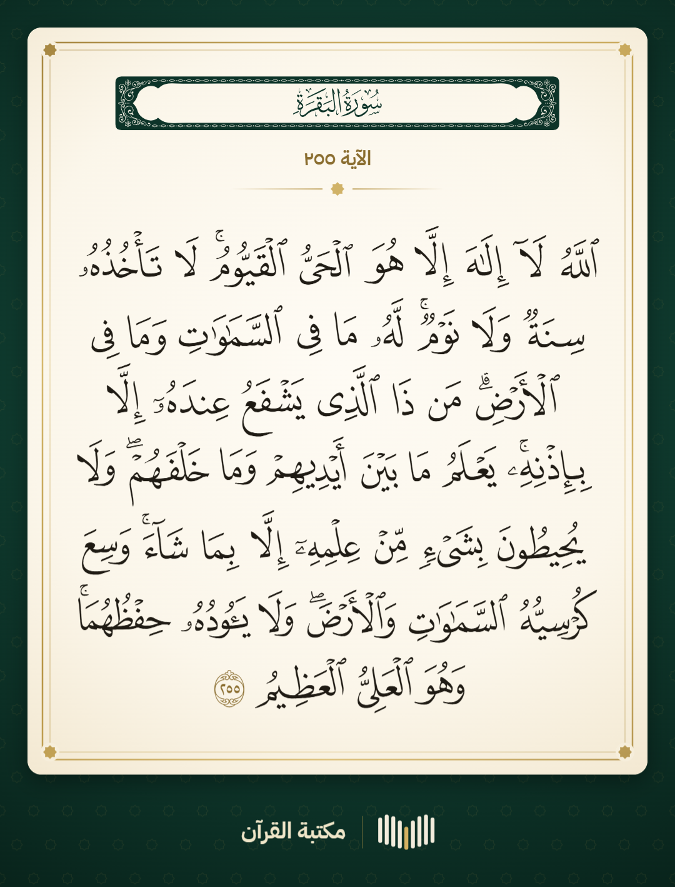
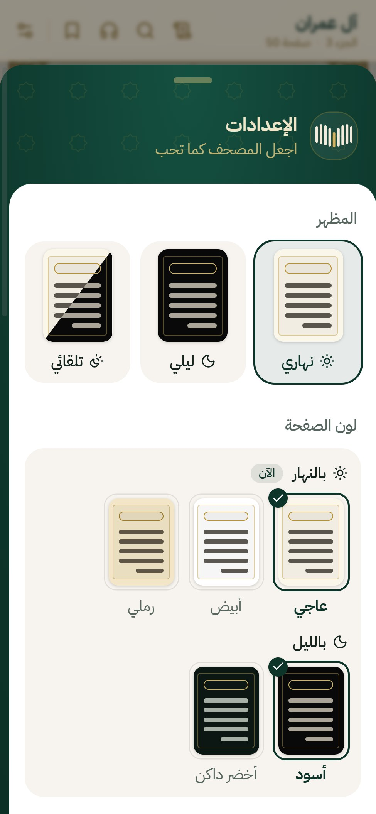
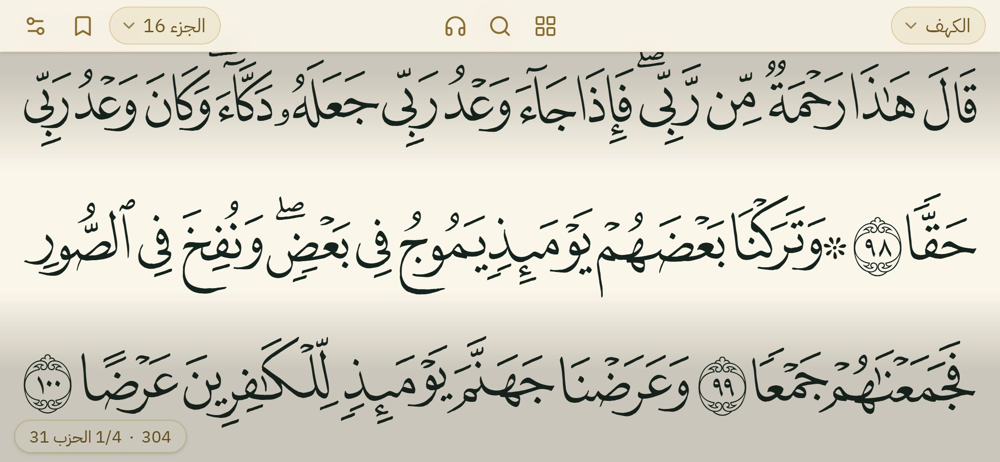

<p align="center">
  
</p>

<h1 align="center">Kur'an Kütüphanesi</h1>

<p align="center">
  <b>Basıldığı gibi Mushaf: ekranınızda açık bir kitap, kelime kelime, sekiz kâriyle.</b><br>
  Açık kaynak ve ücretsiz: Hafiz platformumuzun canlı ortamda çalıştırdığı Mushafın ta kendisi, sitenize ya da
  uygulamanıza hazır.
</p>

<p align="center"><a href="README.ar.md">العربية</a> · <a href="README.md">English</a> · <b>Türkçe</b></p>

<p align="center">
  
</p>

<p align="center">
  
  
  
  
</p>

## Neler sunar

- **Basılı sayfa.** Kral Fahd Kompleksi'nin 1421H Medine Mushafı (Quran.com ve Tarteel'in gösterdiği Mushaf); 604
  sayfa, her sayfada 15 satır, Kompleks'in kendi sayfa yazı tipleriyle ve hiç değiştirilmeden çizilir: her ekranda
  baskının birebir aynısı görünür.
- **Bilgisayarda açık bir kitap.** İki sayfa sırtta buluşur; çevirirken sayfa kenarından kalkar ve sırtın üzerinden
  3B olarak yatar. Sayfayı sürükleyin, ← / → tuşlarına basın ya da okları kullanın.
- **Telefon için tasarlandı.** Sayfa ekranı doldurur, çubuklar çekilir; bir dokunuş onları geri getirir. Telefonu yan
  çevirin: Mushaf tam genişlikte akar, sayfaların arasında sayfa numarası ve hizbin çeyreği yazar.
- **Kelime kelime.** Her kelime suresini, ayetini ve yerini bilen ayrı bir öğedir. Bir ayete basılı tutun: onu tek
  başına dinleyin ya da baskıya yakışır bir resim olarak paylaşın.
- **Metinle eş zamanlı sekiz kâri.** Husari, Minşavi, Şureym, Muaykıli, Devseri, Afasi, Abdülbasit ve Ali Cabir: sayfa
  başına tek ses dosyası, okunan ayeti her satırda tek, düz bir şerit işaretler, sayfa kendiliğinden çevrilir; bir
  ayeti ya da bir bölümü tekrarlayın, hızı değiştirin, kilit ekranını kullanın.
- **Gündüz ve gece, istediğiniz gibi.** Açık, koyu ya da otomatik; gündüz (krem, beyaz, kum) ve gece (siyah, koyu
  yeşil) için sayfa rengi; sayfa çevirme animasyonu, ekranı açık tutma, kâriyi takip etme; Arapça / İngilizce / Türkçe.
- **Fihrist ve arama.** Sureler, cüzler ve yer imleri tek ekranda; ayetlerde ve sure adlarında harekeli ya da
  harekesiz, hemzeli ya da hemzesiz, elifin her biçimiyle arayın.
- **Hızlı, hafif, çevrimdışı.** Sayfa başına tek istek, bir yıl önbellekte kalan dosyalar; okunan her sayfa cihazda
  saklanır, Mushafın tamamı ise yalnızca okuyucu isteyince iner.
- **Ücretsiz barındırma.** Ücretsiz kotalar içinde kalan, adım adım bir Cloudflare R2 + Worker kurulumu.
- **Yapay zekâ asistanları için.** [`AGENTS.md`](AGENTS.md) ve bir [Claude Code becerisi](skills/quran-mushaf/SKILL.md),
  bir asistanın Mushafı sizin yerinize uygulamanıza eklemesini sağlar.

<p align="center">
  
</p>

<table>
  <tr>
    <td align="center" width="50%">
      
      <br><sub>Bir ayete basılı tutun → <b>Paylaş</b>: sayfa yazı tipleriyle çizilmiş 1080 piksellik bir resim</sub>
    </td>
    <td align="center" width="50%">
      
      <br><sub>Ayarlar: gündüz / gece / otomatik, sayfa rengi, okuma ve dinleme</sub>
    </td>
  </tr>
</table>

<p align="center">
  
</p>

## İki dakikada başlayın

Node 20 veya üstü gerekir.

```bash
git clone https://github.com/ahmadmounir/quran-library.git
cd quran-library/example
npm install
npm run dev
```

`http://localhost:5175` adresini açın: Mushaf bu deponun `data/` klasöründen çalışır. Ses için bir kâriyi bir kez
oluşturun (Node 20+ ve ffmpeg; yaklaşık bir saat, çoğu indirme):

```bash
node tools/audio/build-reciter.mjs husary    # ya da birkaç kimlik, ya da: all
```

Araç, kârinin kayıtlarını EveryAyah'tan indirir ve ses dosyalarımızı birebir yeniden oluşturur (kontrol eder ve
söyler). Uygulamayı yayına almak için dosyaları kendi Cloudflare Worker'ınızda barındırın (rehber, §8) ve uygulamayı
onların adresiyle derleyin: `VITE_FILES_BASE=https://files.example.com/v1 npm run build` → `example/dist/`.

## Rehber

Veri dosyalarından açık kitaba, barındırmaya, önbelleğe ve maliyete kadar tam açıklama:

- **العربية** — [docs/ar/GUIDE.md](docs/ar/GUIDE.md)
- **English** — [docs/en/GUIDE.md](docs/en/GUIDE.md)
- **Türkçe** — [docs/tr/GUIDE.md](docs/tr/GUIDE.md)

## Depoda neler var

| Klasör | Ne |
|---|---|
| `data/mushaf/` | 604 sayfa dosyası (satırlar ve kelimeler; her kelime glif kodu ve Unicode metniyle), ayet→sayfa indeksi, sureler, arama için düz metin |
| `data/fonts/` | 604 sayfa yazı tipi (QCF V2, 93 MB) ve sure başlığı yazı tipi |
| `data/audio/` | sekiz kâri ve her biri için her ayetin her sayfa dosyasında nerede başladığı |
| `tools/audio/` | sayfa ses dosyalarını ayet kayıtlarından oluşturur (bizimkilerle bayt bayt aynı) |
| `tools/cloudflare/` | R2'ye yükleme; dosyaları sunan Worker |
| `example/` | Mushaf uygulaması (React + Vite + Tailwind): açık kitap, dik ve yan telefon, kâriler, ayet paylaşma, ayarlar, çevrimdışı |
| `AGENTS.md`, `skills/` | yapay zekâ kodlama asistanları için talimatlar |

Ses dosyalarının kendisi (sekiz kâri için 6,2 GB) git'te yok; araçlar onları yeniden oluşturur.

## Yapay zekâ asistanı kullanmak

Kendi projenizi Claude Code'da (ya da herhangi bir kodlama ajanında) açın, bu depoyu ona erişilebilir kılın ve şunu
isteyin:

> Mushafı quran-library/AGENTS.md'yi izleyerek uygulamama ekle

Claude Code ile `skills/quran-mushaf/` klasörünü projenizin `.claude/skills/` klasörüne de kopyalayabilirsiniz.

## Lisans

Bu depo için yazılmış kod ve rehberler [MIT lisansı](LICENSE) altındadır. Fontlar, sayfa verileri ve kayıtlar
sahiplerine aittir (aşağıya bakın).

## Teşekkür

Bu çalışma başkalarının omuzlarında yükseliyor; onlara içtenlikle teşekkür ediyoruz:

- **Kral Fahd Kur'an-ı Kerim Basım Kompleksi** (Medine) — Medine Mushafı ve hiç değiştirilmeden kullanılan sayfa
  fontları (QCF V2).
- **Tarteel — Quranic Universal Library (QUL)** — sayfa dosyalarımızın üzerine kurulduğu sayfa düzeni verileri ve
  kelime kelime glif kodları, ayrıca sure başlığı fontu.
- **Quran.com / Quran Foundation** — kelime kimlikleri ve yolu gösteren açık çalışmaları.
- **EveryAyah.com** — ses dosyalarımızın üzerine kurulduğu ayet ayet kayıtlar.
- **Kâriler** — Şeyh Mahmud Halil el-Husari, Şeyh Muhammed Sıddık el-Minşavi, Şeyh Suud eş-Şureym, Şeyh Mahir
  el-Muaykıli, Şeyh Yasir ed-Devseri, Şeyh Mişari Raşid el-Afasi, Şeyh Abdülbasit Abdüssamed ve Şeyh Ali Cabir —
  Allah onlardan razı olsun.

Fontların, sayfa verilerinin ve kayıtların bütün hakları sahiplerine aittir. Bunları burada, Allah'ın Kitabına hizmet
eden herkese ticari olmayan bir hizmet olarak ücretsiz paylaşıyoruz. Ticari bir şey geliştiriyorsanız önce her
kaynağın kullanım koşullarını okuyun.
